 

  
  

France 🇫🇷 · Freelance developer · Founder of eDeveloppe

## What I do

I help businesses turn ideas and operational needs into **custom, reliable software**.

My work covers the full delivery cycle, from **frontend and UX** to **backend, APIs, data, automation and deployment**, with a strong focus on **performance, security and long-term maintainability**.

## Core stack

## How I work

`Business-first thinking` · `Direct collaboration` · `Clear scope` · `Custom development` · `Maintainable code`

I prefer understanding the real need first, then choosing the right architecture and tools around it.

That means no unnecessary complexity, no trend-driven decisions, and no one-size-fits-all solutions.

## GitHub insights

## Selected technical focus

## Let’s work together

You talk directly to me, from the first conversation to delivery. We define the steps together and validate each one before moving on.

| 1. Scoping | 2. Design | 3. Development | 4. Delivery |
|---|---|---|---|
| We identify your users, your processes and the priority features. | I design the user flows, the interfaces and the architecture. | Features and connections to your tools are built and tested. | I support you through deployment and handover. |

**Free first conversation** · **No commitment** · **Clear scope in the quote** · **Reply within 24 business hours** · [Money-back guarantee on eligible services](https://www.edeveloppe.com/site-web-satisfait-ou-rembourse)

[Tell me about your project](https://www.edeveloppe.com/contact) or write to [contact@edeveloppe.com](mailto:contact@edeveloppe.com).

