## What I do

As a freelance developer and the founder of eDeveloppe, I help businesses turn ideas and operational needs into **custom, reliable software**.

My work covers the full delivery cycle, from **frontend and UX** to **backend, APIs, data, automation and deployment**, with a strong focus on **performance, security and long-term maintainability**.

## Core stack

## How I work

I prefer understanding the real need first, then choosing the right architecture and tools around it.

That means no unnecessary complexity, no trend-driven decisions, and no one-size-fits-all solutions.

## GitHub insights

## Let’s work together

**Free first conversation** · **No commitment** · **Clear scope in the quote** · **Reply within 24 business hours** · [Money-back guarantee on eligible services](https://www.edeveloppe.com/site-web-satisfait-ou-rembourse)

[Tell me about your project](https://www.edeveloppe.com/contact) or write to [contact@edeveloppe.com](mailto:contact@edeveloppe.com).
